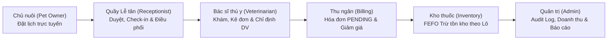
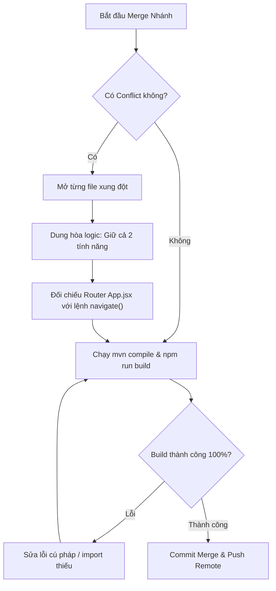

# CẨM NANG TOÀN DIỆN: PHƯƠNG PHÁP XÂY DỰNG DỰ ÁN HOÀN HẢO CÙNG AI
> **Phân tích ca điển hình (Case Study):** Dự án Hệ thống Quản lý Phòng khám Thú y — **PCMS (Pet Clinic Management System)**  
> **Công nghệ nền tảng:** Java 21, Spring Boot 3.5.x, Spring Security (Stateless JWT + RBAC), SQL Server, React 19 (Vite), Tailwind & CSS Scoped.

---

## MỤC LỤC
1. [Bản Mổ xẻ Dự án PCMS: Cấu trúc & Các Bài học Xương máu](#1-bản-mổ-xẻ-dự-án-pcms-cấu-trúc--các-bài-học-xương-máu)
2. [Quy trình 6 Bước Làm Dự án Hoàn hảo Cùng AI (The 6-Phase AI Playbook)](#2-quy-trình-6-bước-làm-dự-án-hoàn-hảo-cùng-ai-the-6-phase-ai-playbook)
3. [Kỹ thuật Prompting & Quản trị Ngữ cảnh (Context Management)](#3-kỹ-thuật-prompting--quản-trị-ngữ-cảnh-context-management)
4. [Chiến lược Hợp nhất Nhánh (Multi-Branch Merge & Conflict Resolution)](#4-chiến-lược-hợp-nhất-nhánh-multi-branch-merge--conflict-resolution)
5. [Bộ Tiêu chuẩn Nghiệm thu Cốt lõi (Definition of Done - DoD)](#5-bộ-tiêu-chuẩn-nghiệm-thu-cốt-lõi-definition-of-done---dod)
6. [Bộ Prompt Mẫu Áp dụng Ngay cho Dự án Tiếp theo](#6-bộ-prompt-mẫu-áp-dụng-ngay-cho-dự-án-tiếp-theo)

---

## 1. BẢN MỔ XẺ DỰ ÁN PCMS: CẤU TRÚC & CÁC BÀI HỌC XƯƠNG MÁU

Để hiểu cách điều phối AI hoàn thành một dự án phần mềm lớn, hãy nhìn vào chính bức tranh kiến trúc của **PCMS**. Đây là một dự án phức tạp vì sở hữu **5 phân hệ người dùng** gắn kết chặt chẽ theo một chuỗi giá trị khép kín:



### 1.1. Chuỗi giá trị nghiệp vụ (The End-to-End Chain)
1. **Lễ tân (`Receptionist`)**: Tiếp nhận lịch hẹn trực tuyến (`PENDING_APPROVAL`) hoặc khách vãng lai (Walk-in), xác nhận (`CONFIRMED`), Check-in phân bổ Bác sĩ (`CHECKED_IN`).
2. **Bác sĩ (`Veterinarian`)**: Bắt đầu ca khám (`IN_PROGRESS`), ghi nhận triệu chứng lâm sàng, chẩn đoán, y lệnh cận lâm sàng (`MedicalRecordDetail`), kê đơn thuốc (`PrescriptionDetail`), hẹn ngày tái khám (`FollowUp`).
3. **Đồng bộ tự động sang Thu ngân**: Khi bác sĩ lưu bệnh án, hệ thống lập tức tính toán:
   $$\text{Tổng tiền} = \sum (\text{Đơn giá DV} \times \text{Số lượng}) + \sum (\text{Đơn giá Thuốc} \times \text{Số lượng})$$
   và sinh một bản ghi `Invoice` ở trạng thái `PENDING`.
4. **Thu ngân (`Billing`)**: Kiểm tra danh sách chờ (`/billing/queue`), chiết khấu (`discountAmount`), xác nhận thanh toán (`PAID`).
5. **Kho thuốc (`Inventory`)**: Khi hóa đơn được thanh toán, giải thuật **FEFO (First Expired, First Out)** tự động quét các lô thuốc (`InventoryBatch`) còn hạn dùng, trừ số lượng tồn kho theo thứ tự ngày hết hạn gần nhất.
6. **Nhật ký & Giám sát (`AuditLog`)**: Mọi bước nhảy trạng thái (Check-in, Khám bệnh, Xác nhận tiền, Hủy hóa đơn Void) đều sinh log có `correlationId` phục vụ kiểm toán.

---

### 1.2. Những "Hố sâu" Thực tế đã gặp trong PCMS và Cách xử lý triệt để

Trong quá trình ghép code giữa các nhánh **Thanh** (Lễ tân), **Nguyệt** (Kho & Thanh toán) và nhánh của bạn, chúng ta đã gặp 5 vấn đề kinh điển mà mọi dự án dùng AI đều sẽ gặp:

| Vấn đề thực tế trong PCMS | Hậu quả nếu không kiểm soát | Giải pháp kiến trúc chuẩn đã áp dụng |
| :--- | :--- | :--- |
| **Lệch URL Điều hướng Frontend** | Nguyệt viết navigate tới `/admin/billing/invoices/...` trong khi App.jsx định nghĩa `/billing/invoices/...` ➔ Bấm vào bị văng 404/trang chủ. | **Audit Router trước khi merge**: Rà soát toàn bộ lệnh `navigate()` trong các page đối chiếu với bảng định tuyến tập trung trong `App.jsx`. |
| **Gãy Logic vì thiếu Seed Data** | Thu ngân thanh toán đơn thuốc nhưng kho chưa có lô hàng (`InventoryBatch`) ➔ Ném lỗi `Insufficient stock for medicine ID`. | **DataInitializer toàn diện**: Khởi tạo sẵn dữ liệu có quan hệ bắc cầu: Thuốc ➔ Lô tồn kho ➔ Đơn thuốc mẫu ➔ Hóa đơn mẫu để test được ngay. |
| **Xung đột cấu hình Spring Properties** | Nhánh Nguyệt đổi cấu hình thành `pcms.jwt.*`, làm `AppProperties` (bắt `@ConfigurationProperties(prefix = "app")`) bị `NullPointerException`. | **Bảo toàn quy chuẩn chung (Standard Contract)**: Phục hồi tiền tố chuẩn `app.*`, hỗ trợ fallback `pcms.*` nếu cần thiết. |
| **Hở tầng Bảo mật Spring Security** | `@PreAuthorize` có khai báo nhưng tầng HTTP filter chưa mở pattern `/api/v1/billing/**` và `/api/v1/inventory/**`. | **Bảo mật đa tầng (Defense in depth)**: Khai báo tường minh role ở `SecurityFilterChain` trước, sau đó mới đến `@PreAuthorize` tại Controller. |
| **Lệch quy ước đặt tên DB (Physical Strategy)** | Thuộc tính Java dùng camelCase (`batchId`), SQL Server dùng PascalCase hoặc camelCase, nếu thiếu naming strategy Hibernate sẽ tự động ép sang snake_case (`batch_id`) gây lỗi bảng không tồn tại. | Cố định `PhysicalNamingStrategyStandardImpl` trong `application.properties`. |

---

## 2. QUY TRÌNH 6 BƯỚC LÀM DỰ ÁN HOÀN HẢO CÙNG AI

Để AI không sinh code rác, không bịa đặt logic (hallucination) và luôn giữ được cấu trúc code sâu (Deep Module), bạn cần tuân thủ nghiêm ngặt chu trình 6 bước:

```
[BƯỚC 1: HỢP ĐỒNG THIẾT KẾ (CONTRACT-FIRST)]
                  ⬇
[BƯỚC 2: BỘ KHUNG ĐI XUYÊN (WALKING SKELETON & SEED)]
                  ⬇
[BƯỚC 3: PHÁT TRIỂN LÁT CẮT DỌC (VERTICAL SLICE WORKFLOW)]
                  ⬇
[BƯỚC 4: RÀ SOÁT TÍNH TOÀN VẸN VÀ TÍNH ĐÓNG GÓI]
                  ⬇
[BƯỚC 5: HỢP NHẤT NHÁNH & ĐỒNG BỘ ĐIỀU HƯỚNG]
                  ⬇
[BƯỚC 6: TỰ ĐỘNG HÓA KIỂM THỬ (AUTOMATED VERIFICATION)]
```

---

### Bước 1: Thiết kế Bản vẽ & Hợp đồng Kỹ thuật (Contract-First Design)
*Đừng bao giờ bảo AI "Hãy code cho tôi chức năng X" khi chưa có bản vẽ.*

1. **Khóa chặt Data Model (Schema & Entity):**
   - Viết ra danh sách Entity, các trường bắt buộc, kiểu dữ liệu (`BigDecimal` cho tiền tệ, `LocalDate` cho ngày, `LocalDateTime` cho mốc thời gian giao dịch).
   - Xác định rõ quan hệ: Ví dụ `Invoice` sở hữu quan hệ 1-1 với `MedicalRecord`, 1-N với `Payment`.
2. **Khóa chặt Response Envelope:**
   Mọi Controller chỉ được phép trả về 1 định dạng chuẩn:
   ```java
   public record ApiResponse<T>(boolean success, String message, T data) {}
   ```
3. **Khóa chuẩn Error Payload (RFC 7807):**
   Gồm `status`, `errorCode`, `message`, `correlationId`, và `fieldErrors` cho các lỗi validation biểu mẫu.

---

### Bước 2: Dựng Bộ khung đi xuyên (Walking Skeleton)
Mục tiêu của bước này: **Hệ thống phải "sống" và chạy được từ Database tới Frontend trước khi viết bất kỳ nghiệp vụ phức tạp nào.**

1. **Hạ tầng Backend:**
   - Spring Security Stateless JWT + RestAuthErrorHandler (trả JSON 401/403 thay vì trang HTML trắng).
   - CorrelationIdFilter: Gán `X-Correlation-ID` cho mỗi request để trace log xuyên suốt.
   - GlobalExceptionHandler: Bắt mọi ngoại lệ (`BadRequestException`, `ResourceNotFoundException`, `AccessDeniedException`).
2. **Hạ tầng Frontend:**
   - `axiosClient`: Tự động đính kèm Bearer token, tự động kèm header `X-Correlation-ID`, bóc tách `response.data`, xử lý logout khi token hết hạn.
   - Layouts & Route Guards theo từng Role: `AdminRouteGuard`, `VetRouteGuard`, `ReceptionistRouteGuard`, `InventoryRouteGuard`, `BillingRouteGuard`.
3. **Bộ dữ liệu giống (DataInitializer):**
   - Phải seed đủ tài khoản cho tất cả các Role kèm mật khẩu chuẩn.
   - Phải có dữ liệu danh mục ban đầu (dịch vụ, thuốc, phòng khám).

---

### Bước 3: Phát triển theo từng Lát cắt Dọc (Vertical Slice Workflow)
Không phát triển theo tầng ngang (không làm hết tất cả Entity, rồi hết Repository, rồi mới tới Controller). Hãy phát triển theo từng **luồng người dùng trọn vẹn (Vertical Slice)**:

$$\text{Database Migration} \longrightarrow \text{Entity} \longrightarrow \text{Repository} \longrightarrow \text{Service Logic} \longrightarrow \text{Controller} \longrightarrow \text{Axios API} \longrightarrow \text{UI Component} \longrightarrow \text{Route Guard}$$

**Thứ tự ưu tiên các lát cắt trong dự án:**
1. **Lát cắt 1: Quản trị & Danh mục gốc (Admin Master Data)**
   - Quản lý tài khoản nhân sự, phân vai trò, danh mục dịch vụ & giá niêm yết.
2. **Lát cắt 2: Luồng tiếp nhận (Upstream Workflow)**
   - Khách đặt lịch ➔ Lễ tân duyệt ➔ Check-in ➔ Phân bổ bác sĩ.
3. **Lát cắt 3: Luồng chuyên môn (Core Clinical Workflow)**
   - Bác sĩ mở ca khám ➔ Chỉ định cận lâm sàng ➔ Kê đơn thuốc ➔ Lên lịch tái khám ➔ Sinh hóa đơn tạm tính.
4. **Lát cắt 4: Luồng hạ nguồn (Downstream Billing & Logistics)**
   - Thu ngân nhận ca ➔ Áp chiết khấu ➔ Thu tiền ➔ Trừ kho FEFO theo lô ➔ Cập nhật trạng thái hoàn tất.
5. **Lát cắt 5: Luồng giám sát & Báo cáo (Audit & Intelligence)**
   - Dashboard thống kê doanh thu, số ca khám, lịch sử thay đổi qua Audit Log.

---

### Bước 4: Kiểm soát Tính Toàn vẹn & Tính Đóng gói (Module Deepening)
Khi giao việc cho AI, cần ép AI tuân thủ nguyên lý thiết kế mô-đun sâu:
- **Service phải dày, Controller phải mỏng**: Controller chỉ làm nhiệm vụ parse request, gọi service và wrap `ApiResponse`. Toàn bộ kiểm tra tính hợp lệ, tính toán tiền, trừ kho, ghi audit log phải nằm trọn vẹn trong Service có `@Transactional`.
- **Nguyên tử hóa giao dịch (Atomicity)**:
  - Nếu bước trừ kho thất bại (hết hàng) ➔ Toàn bộ giao dịch thanh toán phải rollback, không được đổi trạng thái hóa đơn sang `PAID`.
  - Nếu gửi email thông báo thất bại ➔ Bắt ngoại lệ riêng (`try-catch`), **không được** làm rollback giao dịch lưu lịch hẹn của khách.

---

### Bước 5: Hợp nhất Nhánh an toàn (Multi-Branch Merge Protocol)
Khi ghép code của đồng đội (hoặc AI tạo nhánh mới), thực hiện quy trình 4 bước:
1. **Commit sạch nhánh hiện tại**: Đảm bảo working tree không còn file dở dang.
2. **Thực hiện merge không commit ngay (`git merge --no-commit <branch>`)**:
   - Mở toàn bộ file conflict.
   - Tuyệt đối không chọn giải pháp "Accept Theirs" hoặc "Accept Ours" một cách mù quáng. Phải kết hợp cả hai tính năng (giống như cách chúng ta giữ cả tài khoản Lễ tân của bạn và Thủ kho của Nguyệt trong `DataInitializer`).
3. **Rà soát Routing Table**: Mở file `App.jsx`, kiểm tra xem layout mới có bị đè lên layout cũ không, đường dẫn con (`children routes`) có khớp với nút bấm trên giao diện không.
4. **Kiểm tra biên dịch**: Chạy `mvn clean compile` và `npm run build`. Chỉ khi cả hai lệnh thoát với mã `0` mới thực hiện commit merge.

---

### Bước 6: Tự động hóa Kiểm thử & Nghiệm thu (Automated Verification)
Trước khi bàn giao hoặc đưa lên môi trường thật, luôn yêu cầu AI viết hoặc chạy một kịch bản kiểm thử tích hợp (End-to-End Script như `test_flows.ps1` hoặc `test_flows.mjs`):
- Tự động login từng tài khoản để lấy Bearer token.
- Kiểm tra ma trận phân quyền: Lễ tân không được xóa tài khoản Admin; Bác sĩ không được duyệt kho; Khách hàng không được sửa hóa đơn.
- Kiểm tra tính toán số học: Tổng tiền hóa đơn phải khớp chính xác đến từng đồng so với đơn giá thuốc và dịch vụ.

---

## 3. KỸ THUẬT PROMPTING & QUẢN TRỊ NGỮ CẢNH (CONTEXT MANAGEMENT)

AI không thông minh hơn ngữ cảnh bạn cung cấp cho nó. Để AI code không bị "ngáo" hoặc phá vỡ cấu trúc cũ, hãy áp dụng các nguyên tắc sau:

### 3.1. Cấu trúc Prompt Chuẩn 4 Thành phần (The C-T-C-V Formula)
Mỗi prompt yêu cầu AI làm việc phải có đủ 4 yếu tố:
1. **Context (Bối cảnh)**: Công nghệ đang dùng, module đang làm việc, file liên quan.
2. **Task (Nhiệm vụ cụ thể)**: Chỉ rõ nghiệp vụ cần bổ sung (1 việc duy nhất).
3. **Constraints (Ràng buộc cứng)**: Những thứ AI KHÔNG ĐƯỢC PHÉP thay đổi hoặc vi phạm.
4. **Verification (Yêu cầu nghiệm thu)**: Lệnh kiểm tra code sau khi sinh xong.

### 3.2. Quản lý Context Window (Tránh tràn bộ nhớ AI)
- **Không paste cả file 2000 dòng vào chat**: Chỉ cung cấp Interface, Entity hoặc đoạn code đang cần mở rộng.
- **Dùng tính năng Slash Commands khi cần**:
  - `/plan`: Khi chuẩn bị bắt đầu một tính năng mới cần bàn bạc phương án.
  - `/boost`: Khi gặp lỗi hóc búa cần suy nghĩ đa chiều.
  - `/compact`: Khi lịch sử chat đã quá dài để dọn dẹp bộ nhớ đệm.

---

## 4. CHIẾN LƯỢC HỢP NHẤT NHÁNH & GIẢI QUYẾT XUNG ĐỘT

Khi làm việc theo nhóm, kịch bản merge luôn là nơi dễ phát sinh lỗi logic nhất. Dưới đây là bảng tra cứu phản xạ khi merge code:



### Các nguyên tắc vàng khi xử lý xung đột:
1. **Xung đột ở file Cấu hình (`application.properties` / `yml`)**:
   - Ưu tiên sử dụng cú pháp biến môi trường có giá trị mặc định fallback:  
     `${DB_PASSWORD:Sa@123456Abc!}` thay vì gán cứng chuỗi `password=sa`.
2. **Xung đột ở file Khởi tạo (`DataInitializer.java`)**:
   - Không được xóa role hoặc tài khoản của nhánh khác. Hợp nhất thành danh sách đầy đủ.
   - Thêm điều kiện kiểm tra tồn tại (`if (!repository.existsBy...)`) trước khi lưu để tránh lỗi duplicate khóa chính.
3. **Xung đột ở Route Guard / Navbar**:
   - Đảm bảo mỗi Role đều có một Landing Page mặc định hợp lệ sau khi đăng nhập thành công.

---

## 5. BỘ TIÊU CHUẨN NGHIỆM THU CỐT LÕI (DEFINITION OF DONE - DoD)

Một tính năng hoặc một nhánh chỉ được phép coi là **Hoàn thành (Done)** khi đạt đủ 8 tiêu chí kiểm tra:

- [ ] **1. Compile & Build**: `mvn clean compile` và `npm run build` không lỗi, không có import mồ côi.
- [ ] **2. Transaction Safety**: Các tác vụ thay đổi nhiều bảng dữ liệu (như Thanh toán ➔ Trừ kho) được gắn `@Transactional`.
- [ ] **3. Security Filter**: Endpoint mới được cấp quyền chính xác trong `SecurityConfig` và đồng bộ với `@PreAuthorize`.
- [ ] **4. Navigation Sync**: Không có link bấm nào dẫn tới trang trắng hoặc route 404.
- [ ] **5. Error Handling**: Mọi lỗi nhập liệu từ Form đều nhận về message tiếng Việt rõ ràng, không hiện stacktrace Java thô ra UI.
- [ ] **6. UI Feedback**: Mọi nút submit đều có trạng thái disabled khi đang gửi request (`submitting = true`).
- [ ] **7. Audit Trail**: Các hành động quan trọng (Hủy, Sửa, Xác nhận tiền) đều được ghi vào bảng `AuditLog`.
- [ ] **8. Seed Consistency**: Sau khi xóa database và chạy lại từ đầu, hệ thống tự động nạp dữ liệu chạy trơn tru mà không cần can thiệp thủ công.

---

## 6. BỘ PROMPT MẪU ÁP DỤNG NGAY CHO DỰ ÁN TIẾP THEO

Bạn có thể copy trực tiếp các mẫu prompt này để làm việc với AI trong các dự án sau:

### Mẫu 1: Khởi tạo Kiến trúc & Hạ tầng chuẩn (Phase 1)
```text
Tôi đang xây dựng dự án [Tên dự án] bằng Spring Boot 3 (Java 21) và React 19 (Vite).
Hệ thống gồm các vai trò người dùng: [Danh sách Role].
Hãy giúp tôi thiết lập tầng Hạ tầng nền tảng (Foundation) gồm:
1. SecurityConfig chuẩn Stateless JWT, phân quyền theo Role, cấu hình RestAuthErrorHandler trả JSON chuẩn khi gặp lỗi 401/403.
2. GlobalExceptionHandler chuẩn RFC 7807 bắt mọi exception và trả về ApiResponse<T> thống nhất.
3. CorrelationIdFilter tự động sinh mã X-Correlation-ID cho mỗi request và ghi vào MDC log.
4. Cấu hình axiosClient trên Frontend tự động gắn token, tự động forward correlationId và bóc tách dữ liệu chuẩn.
Yêu cầu: Không viết code demo giả lập, hãy viết code hoàn chỉnh có thể biên dịch được ngay.
```

### Mẫu 2: Phát triển một Lát cắt Dọc (Vertical Slice)
```text
Trong dự án [Tên dự án], tôi cần triển khai lát cắt nghiệp vụ: [Tên tính năng, ví dụ: Xác nhận thanh toán hóa đơn và trừ kho FEFO].
Bối cảnh:
- Entity liên quan: [Invoice, Payment, InventoryBatch, Medicine].
- Điều kiện nghiệp vụ: Hóa đơn phải ở trạng thái PENDING; chỉ hỗ trợ phương thức CASH/CARD; trừ số lượng thuốc theo lô có hạn dùng gần nhất còn hạn (FEFO); nếu thiếu hàng phải rollback toàn bộ.
Hãy tạo trọn vẹn lát cắt này:
1. DTO Request & Response chuẩn Validation.
2. Repository query cần thiết.
3. Service implementation có @Transactional và ghi AuditLog.
4. Controller RESTful có @PreAuthorize đúng vai trò.
5. API client và Component giao diện React có xử lý loading, error alert, modal xác nhận.
Ràng buộc: Giữ nguyên các API cũ, chạy lệnh test-compile kiểm tra trước khi kết thúc.
```

### Mẫu 3: Rà soát & Hợp nhất Nhánh (Merge & Flow Audit)
```text
Tôi vừa kéo nhánh [Tên nhánh] về để merge vào nhánh của tôi.
Hãy đóng vai trò Lead Software Architect:
1. Kiểm tra toàn bộ git diff giữa 2 nhánh, liệt kê các điểm xung đột tiềm ẩn về Schema Database, Router và Bảo mật.
2. Rà soát file App.jsx và các component Sidebar/Navbar xem có đường dẫn nào bị lệch (broken routes) so với các page mới thêm không.
3. Đảm bảo file DataInitializer giữ đầy đủ tài khoản và dữ liệu kiểm thử của cả 2 nhánh.
4. Hướng dẫn tôi giải quyết conflict chi tiết từng file và chạy verify build hoàn chỉnh.
```

---
*Tài liệu này được tạo ra và lưu trữ trực tiếp tại thư mục gốc dự án: `AI_DEVELOPMENT_PLAYBOOK_PCMS.md`.*

