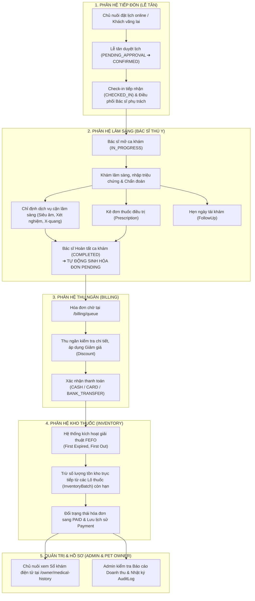

# BẢN QUY CHUẨN KỸ THUẬT & HƯỚNG DẪN LÀM VIỆC DỰ ÁN PCMS
> **Tên dự án:** Pet Clinic Management System (PCMS)  
> **Dành cho:** Toàn bộ thành viên đội ngũ phát triển (Full-stack Developers)  
> **Phiên bản:** 1.0 — Chuẩn hóa quy trình làm việc độc lập & hợp tác cùng AI  

---

## MỤC LỤC
1. [Tổng quan Dự án & Sơ đồ Luồng Dữ liệu Liên thông (E2E Blueprint)](#1-tổng-quan-dự-án--sơ-đồ-luồng-dữ-liệu-liên-thông-e2e-blueprint)
2. [Bản Đồ Phân công Trách nhiệm Module (Module Ownership)](#2-bản-đồ-phân-công-trách-nhiệm-module-module-ownership)
3. [Hợp đồng Kỹ thuật Bắt buộc Toàn đội (Global Technical Contracts)](#3-hợp-đồng-kỹ-thuật-bắt-buộc-toàn-đội-global-technical-contracts)
4. [Quy trình 6 Bước Chuẩn mực khi Làm một Tính năng (Step-by-Step Workflow)](#4-quy-trình-6-bước-chuẩn-mực-khi-làm-một-tính-năng-step-by-step-workflow)
5. [Quy tắc Điều phối AI khi Code Riêng (AI Collaboration Protocol)](#5-quy-tắc-điều-phối-ai-khi-code-riêng-ai-collaboration-protocol)
6. [Quy trình Git, Tạo Pull Request & Bảng Kiểm Merge (Merge Checklist)](#6-quy-trình-git-tạo-pull-request--bảng-kiểm-merge-merge-checklist)

---

## 1. TỔNG QUAN DỰ ÁN & SƠ ĐỒ LUỒNG DỮ LIỆU LIÊN THÔNG (E2E BLUEPRINT)

Dự án PCMS là một hệ sinh thái vận hành phòng khám thú y gồm **5 phân hệ người dùng** tác nghiệp nối tiếp nhau theo một chuỗi giá trị khép kín. Bất kỳ thành viên nào khi làm phân hệ của mình **bắt buộc phải hiểu phân hệ đó nhận dữ liệu từ ai và chuyển giao dữ liệu cho ai**.



---

## 2. BẢN ĐỒ PHÂN CÔNG TRÁCH NHIỆM MODULE (MODULE OWNERSHIP)

Mỗi thành viên trong nhóm nhận trách nhiệm làm chủ (Owner) một phân hệ. Khi làm riêng, bạn phải chịu trách nhiệm trọn vẹn từ **Entity ➔ Service ➔ Controller ➔ UI Component ➔ Route Guard**.

### 2.1. Phân hệ 1: Quản trị Hệ thống (Admin Portal)
- **Người phụ trách:** Admin Lead
- **Mục tiêu:** Quản lý tài nguyên dùng chung, nhân sự, bảng giá danh mục và giám sát kiểm toán.
- **Trang giao diện (Frontend):**
  - `/admin/overview`: Dashboard KPI, biểu đồ tổng quan doanh thu và số ca khám.
  - `/admin/accounts`: Tạo mới, sửa thông tin, khóa/mở khóa tài khoản nhân viên.
  - `/admin/roles`: Xem quyền hạn theo các vai trò trong hệ thống.
  - `/admin/services`: Quản lý danh mục dịch vụ khám, xét nghiệm và giá niêm yết.
  - `/admin/medicines`: Quản lý danh mục thuốc, đơn vị tính, giá bán lẻ, ngưỡng cảnh báo tồn kho tối thiểu.
  - `/admin/reports`: Báo cáo doanh thu dịch vụ, doanh thu thuốc theo khoảng thời gian.
  - `/admin/audit-logs`: Nhật ký kiểm toán toàn bộ hoạt động nhạy cảm trong hệ thống.
- **Backend API:** `/api/admin/**` (Chỉ cho phép Role `ADMIN`).
- **Thực thể dữ liệu (Entity):** `UserAccount`, `Role`, `Branch`, `Service`, `Medicine`, `AuditLog`.

---

### 2.2. Phân hệ 2: Bàn Tiếp đón & Quầy Lễ tân (Receptionist Portal)
- **Người phụ trách:** Receptionist Dev
- **Mục tiêu:** Điểm đón đầu tiếp nhận khách hàng, quản lý vòng đời lịch hẹn, check-in và hồ sơ thú cưng.
- **Trang giao diện (Frontend):**
  - `/receptionist/dashboard`: Bàn tiếp đón trong ngày, danh sách ca hẹn sáng/chiều, KPI chờ duyệt.
  - `/receptionist/appointments`: Duyệt (`APPROVE`), Từ chối (`REJECT`), Đổi lịch (`RESCHEDULE`), Hủy lịch (`CANCEL`).
  - `/receptionist/check-in`: Check-in ca hẹn trước & Đăng ký nhanh cho khách vãng lai (Walk-in), điều phối bác sĩ khám.
  - `/receptionist/customers`: Quản lý hồ sơ Chủ nuôi (`PetOwner`) và Thú cưng (`Pet`), xem lịch sử khám bệnh cũ.
  - `/receptionist/services`: Tra cứu nhanh bảng giá dịch vụ để tư vấn tại quầy.
- **Backend API:** `/api/receptionist/**` (Cho phép Role `RECEPTIONIST`, `ADMIN`).
- **Thực thể dữ liệu (Entity):** `Appointment`, `PetOwner`, `Pet`.
- **Điểm bàn giao (Handoff):** Khi Check-in ca khám thành công ➔ Sinh trạng thái `CHECKED_IN` để Bác sĩ nhìn thấy trên bàn làm việc.

---

### 2.3. Phân hệ 3: Bác sĩ Thú y Lâm sàng (Veterinarian Suite)
- **Người phụ trách:** Veterinarian Dev
- **Mục tiêu:** Khám bệnh lâm sàng, lập hồ sơ bệnh án điện tử, chỉ định cận lâm sàng và kê đơn thuốc.
- **Trang giao diện (Frontend):**
  - `/vet/workbench`: Bàn làm việc bác sĩ, danh sách bệnh nhân đang chờ khám trong ngày.
  - `/vet/examination/:recordId`: Màn hình khám bệnh tích hợp:
    - Nhập triệu chứng, nhiệt độ, cân nặng, chẩn đoán sơ bộ, phác đồ điều trị.
    - Chọn y lệnh dịch vụ (chụp phim, xét nghiệm máu, siêu âm) kèm số lượng và ghi chú.
    - Kê đơn thuốc từ kho: chọn thuốc, số lượng, liều dùng ("Uống sau ăn...").
    - Đặt lịch hẹn tái khám (`FollowUp`) sau N ngày.
  - `/vet/records` & `/vet/pets`: Tra cứu lịch sử khám bệnh và hồ sơ thú cưng.
- **Backend API:** `/api/vet/**` (Cho phép Role `VETERINARIAN`, `ADMIN`).
- **Thực thể dữ liệu (Entity):** `MedicalRecord`, `MedicalRecordDetail`, `Prescription`, `PrescriptionDetail`, `FollowUp`.
- **Điểm bàn giao (Handoff):** Khi bấm "Lưu/Hoàn tất khám" ➔ Tự động tính tổng tiền dịch vụ + tiền thuốc và tạo một `Invoice` ở trạng thái `PENDING` cho Thu ngân.

---

### 2.4. Phân hệ 4: Quản lý Kho Dược & Lô Hàng (Inventory Management)
- **Người phụ trách:** Inventory Dev
- **Mục tiêu:** Theo dõi số lượng tồn kho theo từng Lô nhập, quản lý hạn sử dụng, cảnh báo hết hạn và điều chỉnh kiểm kê.
- **Trang giao diện (Frontend):**
  - `/inventory/batches`: Danh sách các lô thuốc trong kho:
    - Hiển thị Mã lô (`batchNumber`), Thuốc, Số lượng tồn, Hạn dùng (`expirationDate`), Nhà cung cấp.
    - Cảnh báo trực quan: 🟢 Còn hạn (> 30 ngày), 🟡 Cảnh báo (≤ 30 ngày), 🔴 Đã hết hạn.
    - Modal Nhập kho lô thuốc mới (`Receive Stock Modal`).
    - Modal Điều chỉnh kiểm kê tồn kho (`Adjust Stock Modal`) do thất thoát/hư hỏng kèm lý do.
- **Backend API:** `/api/v1/inventory/**` (Cho phép Role `INVENTORY_MANAGER`, `ADMIN`).
- **Thực thể dữ liệu (Entity):** `InventoryBatch`, `Medicine`.
- **Ràng buộc:** Cung cấp dữ liệu tồn kho theo lô cho Thu ngân thực hiện trừ kho FEFO.

---

### 2.5. Phân hệ 5: Thu ngân & Thanh toán (Billing & Cashier)
- **Người phụ trách:** Billing Dev
- **Mục tiêu:** Tiếp nhận hóa đơn sau ca khám, áp dụng chính sách giảm giá, thu tiền và thực hiện trừ kho FEFO.
- **Trang giao diện (Frontend):**
  - `/billing/queue`: Hàng đợi hóa đơn chờ thanh toán (`status = 'PENDING'`).
  - `/billing/invoices/:invoiceId`: Chi tiết hóa đơn:
    - Bảng kê chi phí: Dịch vụ + Đơn thuốc.
    - Cập nhật chiết khấu / giảm giá (`discountAmount`).
    - Xác nhận thanh toán (chọn Tiền mặt, Thẻ, Chuyển khoản).
    - Hủy hóa đơn sai sót (Void Invoice) bắt buộc có lý do.
    - Bảng lịch sử các giao dịch thanh toán (`Payment History`).
- **Backend API:** `/api/v1/billing/**` (Cho phép Role `RECEPTIONIST`, `ADMIN`).
- **Thực thể dữ liệu (Entity):** `Invoice`, `Payment`, liên kết tới `PrescriptionDetail` & `InventoryBatch`.
- **Ràng buộc đặc biệt:** Khi xác nhận thanh toán, hệ thống **bắt buộc** quét qua đơn thuốc của ca khám, tìm các lô thuốc còn hạn sử dụng gần nhất của loại thuốc đó trong `InventoryBatch` để trừ dần số lượng (FEFO). Nếu không đủ thuốc tồn kho, giao dịch phải báo lỗi và **không** đổi trạng thái hóa đơn sang `PAID`.

---

## 3. HỢP ĐỒNG KỸ THUẬT BẮT BUỘC TOÀN ĐỘI (GLOBAL TECHNICAL CONTRACTS)

Mọi thành viên khi viết code **tuyệt đối không được tự ý phá vỡ** các quy chuẩn chung dưới đây để đảm bảo code khi ghép vào chạy trơn tru 100%.

### 3.1. Chuẩn giao tiếp API (Response Envelope)
Mọi Controller chỉ được trả về đối tượng `ResponseEntity<ApiResponse<T>>`:
```java
// Thành công có dữ liệu
return ResponseEntity.ok(ApiResponse.success("Thông điệp tiếng Việt", data));

// Thành công không cần dữ liệu
return ResponseEntity.ok(ApiResponse.success("Cập nhật thành công"));
```
*Frontend qua `axiosClient` sẽ tự động bóc tách và trả về đối tượng `{ success: true, message: "...", data: ... }`.*

### 3.2. Chuẩn Xử lý Lỗi & Mã Lỗi (Error Handling)
Khi gặp lỗi nghiệp vụ, hãy ném ngoại lệ tương ứng (được bắt tập trung tại `GlobalExceptionHandler`):
- `BadRequestException("Lý do cụ thể")`: Lỗi dữ liệu không hợp lệ (HTTP 400).
- `ResourceNotFoundException("Không tìm thấy ...")`: Không tìm thấy bản ghi (HTTP 404).
- `AccessDeniedException`: Không có quyền truy cập (HTTP 403).
- **Ràng buộc:** Không bao giờ nuốt lỗi bằng `try-catch` rỗng. Luôn trả về thông báo lỗi tiếng Việt dễ hiểu cho người dùng.

### 3.3. Chuẩn Entity & Database (JPA / SQL Server)
1. **Kiểu dữ liệu tiền tệ:** Bắt buộc dùng `BigDecimal` (`precision = 12, scale = 2`), không dùng `double` hoặc `float` để tránh sai số dấu phẩy động.
2. **Kiểu dữ liệu thời gian:**
   - Ngày sinh, ngày hết hạn: Dùng `LocalDate`.
   - Giờ khám, thời điểm check-in, thanh toán: Dùng `LocalDateTime`.
3. **Quy tắc đặt tên cột & bảng:**
   - Java Entity sử dụng camelCase (`batchId`, `medicineId`, `userAccount`).
   - Giữ nguyên `spring.jpa.hibernate.naming.physical-strategy=org.hibernate.boot.model.naming.PhysicalNamingStrategyStandardImpl` trong `application.properties` để Hibernate không tự đổi tên thành snake_case.

### 3.4. Chuẩn Frontend (Axios & Routing)
1. **Gọi API:** Bắt buộc import và dùng `axiosClient` từ `src/api/axiosClient.js`. Không dùng `fetch` hoặc `axios` trần.
2. **Định tuyến (Routing):**
   - Mọi URL phân hệ đều phải qua Route Guard tương ứng (`AdminRouteGuard`, `VetRouteGuard`, `ReceptionistRouteGuard`, `InventoryRouteGuard`, `BillingRouteGuard`).
   - Kiểm tra kỹ nút quay lại hoặc nút chi tiết: Ví dụ chuyển trang hóa đơn phải dùng `/billing/invoices/${id}`, không gán cứng `/admin/...`.

---

## 4. QUY TRÌNH 6 BƯỚC CHUẨN MỰC KHI LÀM MỘT TÍNH NĂNG (STEP-BY-STEP WORKFLOW)

Khi bắt đầu làm bất kỳ chức năng nào, hãy làm tuần tự theo 6 bước sau:

```
[BƯỚC 1: PULL CODE GỐC & TẠO NHÁNH MỚI]
                  ⬇
[BƯỚC 2: KHẢO SÁT ENTITY & HỢP ĐỒNG API]
                  ⬇
[BƯỚC 3: PHÁT TRIỂN BACKEND SERVICE CÓ TRANSACTION]
                  ⬇
[BƯỚC 4: TRIỂN KHAI FRONTEND & ROUTE GUARD]
                  ⬇
[BƯỚC 5: CHẠY KIỂM THỬ LIÊN THÔNG TẠI CHỖ]
                  ⬇
[BƯỚC 6: BUILD SẠCH & TẠO PULL REQUEST]
```

### Bước 1: Đồng bộ code gốc & Tạo nhánh tính năng
Trước khi gõ code, luôn cập nhật nhánh chính để tránh lệch base commit:
```bash
git checkout nguyen-van-dong
git pull origin nguyen-van-dong
git checkout -b feature/<ten-tinh-nang>
# Ví dụ: feature/receptionist-walkin hoặc feature/inventory-batch-expiry
```

### Bước 2: Khảo sát Entity & Thiết kế DTO
- Xem các bảng liên quan trong `src/main/java/com/pcms/entity/`.
- Tạo DTO riêng cho Request và Response trong thư mục `com.pcms.dto`:
  - Dùng record hoặc class có validation annotations (`@NotBlank`, `@NotNull`, `@Min`).

### Bước 3: Phát triển Backend (Repository ➔ Service ➔ Controller)
1. Viết query cần thiết trong `Repository`.
2. Viết nghiệp vụ trong `Service`:
   - Gắn `@Transactional` cho các hàm thêm, sửa, xóa.
   - Thêm dòng ghi `recordAudit()` cho các thao tác quan trọng để lưu vào `AuditLog`.
3. Khai báo endpoint trong `Controller`:
   - Thêm `@PreAuthorize("hasAnyRole('...')")` tương ứng.
4. Kiểm tra quyền truy cập tầng mạng trong `SecurityConfig.java` để chắc chắn endpoint không bị chặn 403 từ Filter.

### Bước 4: Triển khai Giao diện Frontend (API ➔ Page ➔ App.jsx)
1. Thêm hàm gọi API trong `src/api/<module>Api.js`.
2. Xây dựng Page trong `src/pages/<module>/`:
   - Phải có trạng thái `loading`, thông báo lỗi `error`, thông báo thành công `success`.
   - Nút Submit phải có `disabled={submitting}` để chống người dùng bấm đúp gửi request liên tiếp.
3. Đăng ký Route trong `src/App.jsx` dưới Route Guard phù hợp.
4. Thêm mục điều hướng trên thanh Menu/Sidebar (`Layout.jsx`).

### Bước 5: Kiểm thử liên thông tại chỗ (Self-Testing)
- Đăng nhập đúng Role để thử tính năng.
- Thử nhập sai dữ liệu để xem Form có báo lỗi tiếng Việt không.
- Đăng nhập Role khác để kiểm tra xem hệ thống có chặn không cho vào không (phải hiện 403 hoặc tự động đá về trang phù hợp).

### Bước 6: Build sạch sẽ trước khi tạo PR
Chạy 2 lệnh kiểm tra sống còn tại máy của bạn:
```powershell
# 1. Kiểm tra Backend
mvn clean compile -DskipTests

# 2. Kiểm tra Frontend
cd frontend
npm run build
```
*Chỉ khi cả 2 lệnh trên đều ra màn hình BUILD SUCCESS / built in X ms mà không có lỗi, bạn mới được commit và tạo Pull Request (PR).*

---

## 5. QUY TẮC ĐIỀU PHỐI AI KHI CODE RIÊNG (AI COLLABORATION PROTOCOL)

Khi sử dụng AI (Antigravity, Cursor, Copilot, ChatGPT), nếu bạn không kiểm soát chặt, AI sẽ tự ý sửa code lung tung làm vỡ tính năng của bạn bè trong nhóm. Hãy bắt AI tuân thủ **4 điều cấm kỵ**:

1. **Điều cấm 1: Không được tự ý sửa file Cấu hình cốt lõi:**
   - Không cho AI tự đổi tiền tố trong `application.properties` (ví dụ từ `app.jwt` sang `pcms.jwt`).
   - Không cho AI xóa các cấu hình DB fallback (`${DB_PASSWORD:Sa@123456Abc!}`).
2. **Điều cấm 2: Không được xóa dữ liệu của người khác trong `DataInitializer.java`:**
   - Nếu bạn cần thêm tài khoản mẫu hoặc dữ liệu mẫu cho module của mình, hãy viết thêm vào phần cuối, tuyệt đối **không được** xóa tài khoản Lễ tân, Bác sĩ, Thủ kho, Admin đã có sẵn.
3. **Điều cấm 3: Nguyên tắc cách ly phạm vi (Context Isolation):**
   - Khi ra lệnh cho AI, chỉ mở các file liên quan đến module của mình. Không đưa toàn bộ project vào prompt để AI không viết đè lên các service của thành viên khác.
4. **Mẫu câu ràng buộc bắt buộc kèm theo mỗi Prompt cho AI:**
   > *"Chỉ triển khai logic cho phân hệ [Tên phân hệ]. Giữ nguyên toàn bộ code hiện tại của các phân hệ khác. Đảm bảo tuân thủ cấu trúc `ApiResponse<T>`, giữ nguyên quy ước `application.properties`, sử dụng `@Transactional` và chạy `mvn test-compile` kiểm tra trước khi kết thúc."*

---

## 6. QUY TRÌNH GIT, TẠO PULL REQUEST & BẢNG KIỂM MERGE (MERGE CHECKLIST)

### 6.1. Quy trình Hợp nhất Nhánh (Merge Flow)
Khi ghép một nhánh tính năng vào nhánh chính `nguyen-van-dong`:
```powershell
# 1. Chuyển về nhánh chính và kéo code mới nhất
git checkout nguyen-van-dong
git pull origin nguyen-van-dong

# 2. Thực hiện merge không commit tự động
git merge --no-commit feature/<ten-tinh-nang>

# 3. Nếu có Conflict: Mở file giải quyết, giữ cả tính năng của cả hai bên
# 4. Kiểm tra lại routing và biên dịch
mvn clean compile
cd frontend; npm run build; cd ..

# 5. Commit và push
git commit -m "feat: Merge tinh nang <ten-tinh-nang> vao he thong"
git push origin nguyen-van-dong
```

### 6.2. Bảng kiểm tra 10 điểm trước khi duyệt PR (The 10-Point Checklist)

| STT | Hạng mục kiểm tra | Tiêu chuẩn đạt |
| :---: | :--- | :--- |
| **1** | **Backend Compilation** | Lệnh `mvn clean compile` thành công 100%, không thiếu thư viện. |
| **2** | **Frontend Production Build** | Lệnh `npm run build` tạo bundle dist sạch sẽ, không có syntax error. |
| **3** | **Router Alignment** | Mọi URL trong `navigate()` và `Link to` đều tồn tại trong `App.jsx`. |
| **4** | **DataInitializer Integrity** | Còn đủ 5 tài khoản mẫu (`admin`, `receptionist`, `vet`, `inventory`, `petowner`). |
| **5** | **Security Defense** | Đã khai báo bảo vệ URL trong `SecurityConfig` và method trong Controller. |
| **6** | **Database Transaction** | Mọi thao tác ghi/xóa từ 2 bảng trở lên đều có `@Transactional`. |
| **7** | **Audit Trail** | Các hành động tạo ca, check-in, hủy hóa đơn, duyệt lịch đều sinh `AuditLog`. |
| **8** | **Error Format** | Bắt lỗi trả về JSON chuẩn, có thông báo tiếng Việt rõ nghĩa. |
| **9** | **UI Responsiveness** | Bảng dữ liệu có thanh cuộn ngang trên màn hình nhỏ, nút bấm có trạng thái loading. |
| **10**| **No Secret Leak** | Không push mật khẩu thật, file `.env` cá nhân hoặc file nén thừa (`.zip`, `.rar`) lên Git. |

---
*Tài liệu này được lưu trữ trực tiếp tại thư mục gốc dự án: `TEAM_DEVELOPMENT_SPEC_PCMS.md`. Mọi thành viên trong nhóm bắt buộc đọc kỹ trước khi bắt tay vào viết code.*
